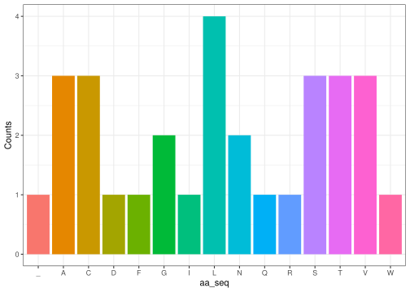

MolBioR
================

``` r
library(MolBioR)
```

The package: `MolBioR` allow the user to quickly walk-through the
central dogma in R, and includes five functions.

The first function `DNA_seq_generator` creates an arbitrary DNA sequence
of a given length:

``` r
test_DNA <- DNA_seq_generator(90)
test_DNA
#> [1] "GTCACTGCCAGCGCCGACCTAGCGGTTCTAAATTGGAACATTACGTGCTAACAGGGTCTAAGTGTGTCCCTGTGCACTTTCCGGTGTGGA"
```

The second function then takes the `DNA_seq` from the previous function,
and transcribes it into RNA. If you want to analyze your own DNA
sequence, just input that in the function.

``` r
RNA_test <- DNAtoRNA(test_DNA)
RNA_test
#> [1] "GUCACUGCCAGCGCCGACCUAGCGGUUCUAAAUUGGAACAUUACGUGCUAACAGGGUCUAAGUGUGUCCCUGUGCACUUUCCGGUGUGGA"
```

The third function `codon_reader` splits the RNA string into codons. The
function has an optional parameter called `start=1`, which determines
from which RNA index the open reading frame is set to begin from. It
only takes RNA nucleotides, and will raise an error if blank space or
other characters is included in the string. The user has to correct this
themselves.

``` r
codon_reader("ABCDE ")
```

``` r
codon_test <- codon_reader(RNA_test)
codon_test
#>  [1] "GUC" "ACU" "GCC" "AGC" "GCC" "GAC" "CUA" "GCG" "GUU" "CUA" "AAU" "UGG"
#> [13] "AAC" "AUU" "ACG" "UGC" "UAA" "CAG" "GGU" "CUA" "AGU" "GUG" "UCC" "CUG"
#> [25] "UGC" "ACU" "UUC" "CGG" "UGU" "GGA"
```

The fourth function: `Translation` takes codons, and translates them
into amino acid:

``` r
aa_test <- Translation(codon_test)
aa_test
#> [1] "VTASADLAVLNWNITC_QGLSVSLCTFRCG"
```

The fifth and final function `aa_distribution_plot` creates a plot to
visualize the distribution of the amino acids in the sequence.

``` r
pl <- aa_distribution_plot(aa_test)
pl
```

<!-- -->
